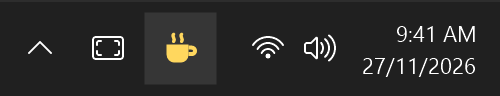
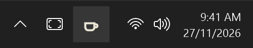

# Mouse Nudge

[](https://github.com/Rushzel/mouse-nudge/releases/latest)
[](https://github.com/Rushzel/mouse-nudge/actions)

[](LICENSE)

A coffee cup in the taskbar that keeps your PC from going idle. Click it on, click it off.

<p align="center"></p>

I wanted a one-click way to keep my PC from going idle when I step away, sitting next to my other taskbar toggle, [Resolution Switch](https://github.com/Rushzel/resolution-switch). I also have an OLED, so I didn't want something that leaves the screen lit for hours. This one blacks the screen out while it keeps things awake.

**[Download MouseNudge.exe](https://github.com/Rushzel/mouse-nudge/releases/latest/download/MouseNudge.exe)**

## Get it

1. Download `MouseNudge.exe` from the [latest release](https://github.com/Rushzel/mouse-nudge/releases/latest).
2. Put it in its own folder, like `%LOCALAPPDATA%\Programs\Mouse Nudge`, and run it.
3. It isn't signed, so SmartScreen will warn you. Click **More info**, then **Run anyway**. Or build it yourself, it's one file.

It needs .NET Framework 4.8, which Windows 10 (1903 and later) and Windows 11 already have. The cup shows up in the taskbar corner. If it's hidden, drag it out of the hidden icons arrow.

## Use it

- **Left-click** turns it on or off. A gold cup with steam means on, an empty outline means off.
- **Right-click** to turn it on or off, turn on Start with Windows, or exit.
- **Hover** to see whether it's on.

It always starts off.

<p align="center"></p>

## What it does while it's on

- Moves the mouse 1 pixel and back once a minute, so Windows and your apps see activity. You won't notice it.
- Tells Windows not to sleep.
- After 3 minutes with no real keyboard or mouse input from you, it covers every screen in black and hides the cursor, so nothing burns in. It doesn't take focus from whatever you're doing.
- Any key press or mouse move takes the black screen away.

Turning it off or exiting lets Windows sleep normally again.

## Start with Windows

Tick it in the right-click menu. It adds a `MouseNudge` value under `HKCU\Software\Microsoft\Windows\CurrentVersion\Run`, and unticking removes it. If you move the exe, tick it again.

## Limits

- Watching a video for more than 3 minutes without touching anything while it's on brings up the black screen. Move the mouse to get the video back, or turn it off first.
- Because it nudges the mouse, Windows' own screen-off timer never runs while it's on. The black screen is what stands in for it.
- It keeps the PC awake, not the screen. That's on purpose.

## Build it yourself

No Visual Studio needed, the compiler comes with Windows.

```
git clone https://github.com/Rushzel/mouse-nudge
cd mouse-nudge
.\build.ps1
```

That builds the exe and runs the self-test. `.\MouseNudge.exe --self-test | Write-Output` checks the idle timing on its own, without moving the mouse.

GitHub Actions builds every push, and a tag like `v1.1.0` publishes a release.

## License

[MIT](LICENSE)
